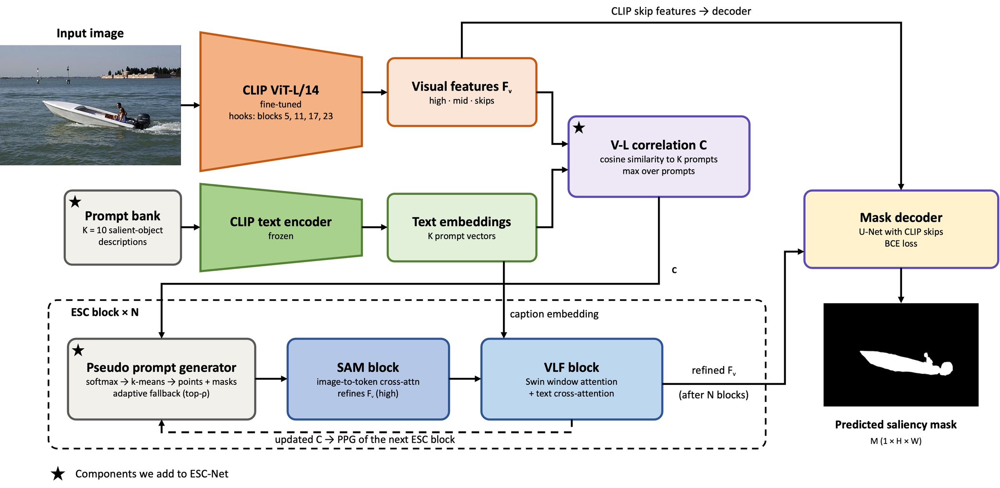

# SPC-Net: Salient Prompt Combination for Foundation-Model Salient Object Detection

Official code for the paper accepted at the **LVR Workshop @ WACV 2027**.

Muhammad Abbas¹, Mohammad Farhad Bulbul², Tanveer Hussain³, Amin Ullah⁴
¹Bacha Khan University Charsadda · ²Jashore University of Science and Technology · ³Edge Hill University · ⁴The Boeing Company

<p align="center">
  
</p>

SPC-Net adapts the SAM–CLIP correlation paradigm (ESC-Net) to class-agnostic, binary salient object detection. It uses a fine-tuned CLIP ViT-L/14 encoder, a bank of salient-object prompts, and a pseudo-prompt generator with an adaptive fallback. The paper also contains a controlled comparative study of the adaptation choices (prompt bank, aggregation, prompt residual, fusion, decoder, loss, encoder fine-tuning). This repository reproduces every SPC-Net number in the paper.

## Repository structure

```
.
├── clipsam.py              # model, training, evaluation (single entry point)
├── requirements.txt
├── LICENSE
├── scripts/                # shell scripts
│   ├── configs.sh          # flags of every configuration in the paper
│   ├── train.sh            # train + evaluate one configuration / seed
│   ├── evaluate.sh         # evaluate an existing checkpoint
│   ├── reproduce_paper.sh  # run all paper experiments, then score and summarise
│   └── prepare_sip_full.sh # build the 929-image SIP evaluation set
└── tools/                  # Python utilities
    ├── score_metrics.py    # S-measure, E-measure, F-measure, MAE (PySODMetrics)
    ├── compute_f05.py      # mean per-image F-beta at a fixed 0.5 threshold
    ├── summarize.py        # mean ± std over seeds, paper-style table
    └── grad_diagnostic.py  # gradient / input-sensitivity check (Sec. 3.5, 4.5)
```

## Installation

```bash
conda create -n spcnet python=3.10 -y
conda activate spcnet
pip install -r requirements.txt
```

`requirements.txt` pins PyTorch 2.3.1 with CUDA 12.1; change the index URL if your driver needs a different build. CLIP ViT-L/14 (OpenAI weights) is loaded by `open_clip`. The SAM ViT-B checkpoint is downloaded automatically to `pretrained_models/sam_vit_b.pth` on the first run (override with `--sam-checkpoint`).

## Datasets

Place the datasets under `./data`, or point `SOD_DATA_ROOT` to their location:

```
data/
├── DUTS_Dataset/DUTS-TR/{DUTS-TR-Image,DUTS-TR-Mask}   # training (10,553 images)
├── DUTS_Dataset/DUTS-TE/{DUTS-TE-Image,DUTS-TE-Mask}   # 5,019
├── DUT-O/{DUT-OMRON-image,pixelwiseGT-new-PNG}          # 5,168
├── ECSSD/{images,ground_truth_mask}                     # 1,000
├── HKU-IS/{images.npy,gt.npy}                           # 4,447
├── pascals-full/PASCALS/                                # 850 (.jpg images and .png masks in one folder)
└── SIP_Dataset/{Train,Test}/{Images,Masks}              # 929 in total
```

Then build the full SIP evaluation set (models never train on SIP, so all 929 images are used, as in the RGB-D literature):

```bash
export SOD_DATA_ROOT=/path/to/data   # optional
bash scripts/prepare_sip_full.sh
```

## Reproducing the paper

All runs use 30 epochs, batch size 8, AdamW, and one A100 GPU (about 5 h per run). Every run evaluates on all six benchmarks with a fixed threshold of 0.5 and saves continuous saliency maps.

```bash
# SPC-Net, seed 42 (Tables 1 and 2)
bash scripts/reproduce_paper.sh main 0

# Prompt-side study (Table 3) and architecture/training study (Table 4), on 4 GPUs
bash scripts/reproduce_paper.sh table3 0 1 2 3
bash scripts/reproduce_paper.sh table4 0 1 2 3

# Everything
bash scripts/reproduce_paper.sh all 0 1 2 3
```

The script skips finished runs, scores all runs, and prints mean ± std over seeds. To summarise another metric:

```bash
python tools/summarize.py --root outputs --metric MAE      # or F05, meanE, maxF
```

### Configurations

Defined in `scripts/configs.sh`; run any single one with `bash scripts/train.sh <config> <seed> <gpu>`.

| Config | Paper row | Seeds |
|---|---|---|
| `baseline` | Baseline (single prompt) | 42, 1, 2 |
| `base_af` | + AF | 42 |
| `plus_mp` | + MP | 42 |
| `ours` | **SPC-Net** (+ MP + AF) | 42, 1, 2 |
| `ours_K1`, `ours_K5` | SPC-Net, K = 1 / 5 | 42 |
| `ours_random`, `ours_diverse` | SPC-Net, random / diverse wording | 42 |
| `ours_vlfk`, `ours_vlfk_nores` | SPC-Net + VLF-K (with / without in-block residual) | 42, 1, 2 / 42 |
| `ours_bisam` | SPC-Net + BiSAM | 42 |
| `corr_max`, `corr_max_nores` | Corr-aware, max, residual on / off | 42, 1, 2 |
| `corr_attn`, `corr_attn_nores` | Corr-aware, attention, residual on / off | 42, 1, 2 |
| `corr_max_lpt` | Corr-aware, max, residual on, + point loss | 42, 1, 2 |
| `ours_frozen` | SPC-Net, frozen encoders | 42, 1, 2 |

### Evaluation protocol

- S-measure, mean E-measure and MAE are computed on the continuous saliency map with PySODMetrics (`tools/score_metrics.py`).
- F-measure (β² = 0.3) is the mean per-image value at a fixed threshold of 0.5 (`tools/compute_f05.py`). The threshold is not tuned on any dataset.
- The checkpoint with the best training Dice is used; no test benchmark is used for model selection.

To evaluate an existing checkpoint:

```bash
bash scripts/evaluate.sh ours outputs/ours_s42/escnet_best.pth outputs/eval_ours 0
```

### Expected results (S-measure)

| | DUTS-TE | DUT-OMRON | ECSSD | HKU-IS | PASCAL-S | SIP (929) |
|---|---|---|---|---|---|---|
| SPC-Net, seed 42 | .929 | .884 | .949 | .940 | .896 | .936 |
| SPC-Net, 3 seeds | .928 ± .001 | .883 ± .002 | .949 ± .000 | .940 ± .000 | .897 ± .001 | .935 ± .004 |

Expect run-to-run differences of a few tenths of a point between single runs.

## Additional options

- `--legacy-text-encoder` reproduces an earlier implementation that skipped the CLIP text transformer (for reference only; all paper results use the full, frozen text encoder).
- `--vlf-multi-token` / `--vlf-residual` let the VLF block attend over all bank prompts (VLF-K in Table 3).
- `python tools/grad_diagnostic.py --out outputs/grad_diagnostic` reproduces the gradient-norm and input-sensitivity measurements.

## Citation

```bibtex
@inproceedings{abbas2027spcnet,
  title     = {{SPC-Net}: Salient Prompt Combination for Foundation-Model Salient Object Detection},
  author    = {Abbas, Muhammad and Bulbul, Mohammad Farhad and Hussain, Tanveer and Ullah, Amin},
  booktitle = {Proceedings of the IEEE/CVF Winter Conference on Applications of Computer Vision (WACV) Workshops},
  year      = {2027}
}
```

## License

This project is released under the [MIT License](LICENSE).

## Acknowledgements

This code builds on [ESC-Net](https://arxiv.org/abs/2411.14723), [CAT-Seg](https://github.com/cvlab-kaist/CAT-Seg), [Segment Anything](https://github.com/facebookresearch/segment-anything), [OpenCLIP](https://github.com/mlfoundations/open_clip), and [PySODMetrics](https://github.com/lartpang/PySODMetrics).
